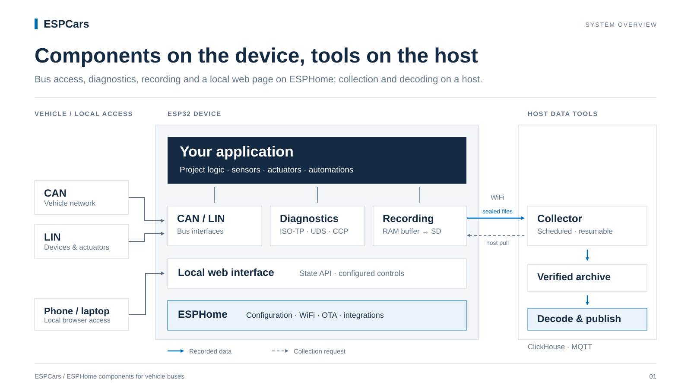
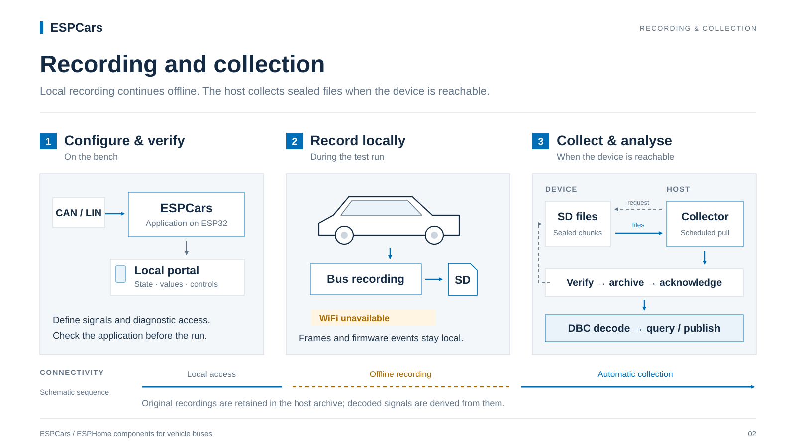
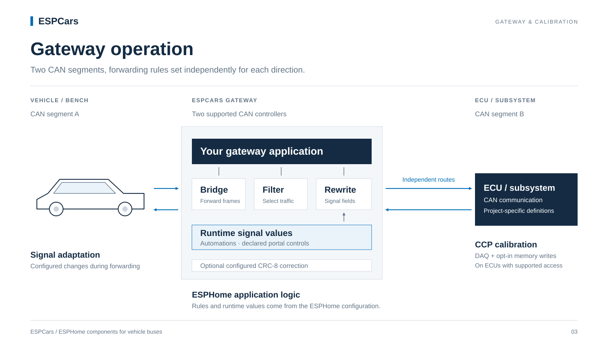

# ESPCars

**ESPHome components for CAN, LIN and vehicle diagnostics on ESP32.**

ESPCars connects an ESP32 to a vehicle's CAN and LIN buses. It decodes bus
traffic and diagnostic data into ESPHome entities, records frames to an SD card,
and can forward or modify frames between two CAN segments. Everything is
configured in ESPHome YAML. The components load through `external_components:`
and run against stock ESPHome (2026.7 or later).



## Application areas

- **Bus analysis on the bench or in the vehicle.** Decode CAN signals into
  sensors, watch per-ID statistics and bus errors, sniff LIN schedules.
- **Diagnostic readout.** Read ECU data over UDS (ISO 14229) or CCP 2.1 and
  publish it as ESPHome sensors.
- **Recording on test drives.** Log CAN and LIN frames to SD without a network
  connection; collect and decode the files on a host afterwards.
- **LIN node simulation and testing.** Run a LIN master schedule or answer as a
  slave.
- **Gateway setups on the bench.** Bridge, filter and rewrite frames between two
  CAN segments for integration tests and signal adaptation.
- **Home Assistant integration.** Vehicle values arrive as ordinary ESPHome
  entities; recorded values can be published over MQTT.

## Functions

### Bus access

- CAN observe and decode: byte and bit-level signals (Intel and Motorola),
  11- and 29-bit IDs, per-ID statistics, bus-off recovery with automations.
  `script/dbc2yaml.py` generates the sensor YAML from a DBC file.
- CAN gateway between two controllers: routes per direction, filter, ID
  translation, signal rewrite with runtime values, optional CRC-8 (E2E)
  correction, cyclic sends. The forwarding path runs in the RX interrupt.
- LIN master and slave: frame schedule, slave responses, classic and enhanced
  checksum, sniffing, self-test, bus statistics.

### Diagnostics

- ISO-TP (ISO 15765-2): normal, normal-fixed and extended addressing, flow
  control.
- UDS (ISO 14229) client: field definitions come from a separately flashed
  catalog (`.dcat`), not from firmware or YAML. Read-only by default; active
  services need `allow_active_services: true`.
- CCP 2.1 master: memory access, DAQ measurement, calibration page selection.
  Memory writes need `allow_write: true`.

### Recording and data

- SD logger for CAN and LIN frames and the ESPHome log. A RAM ring decouples
  bus timing from SD write latency. Files rotate by size or time; power cuts
  are detected per file, and card failures are retried.
- Host tools: unattended collection over WiFi with verification and archive,
  DBC decoding into ClickHouse, diagnostic answers decoded with the device's own
  `.dcat` catalog into signals and events (states, fault codes, negative answers),
  pipeline state and last known values to Home Assistant over MQTT. The archive keeps the original files; decoded data can
  be rebuilt from it.



### Local web interface

- One page and a JSON state API served by the device, built from a tree of
  values and optional controls declared in YAML. Assets are embedded in the
  firmware. An optional login guards the controls; reading state never needs
  one.

## Gateway operation

With two CAN controllers, ESPCars sits between two bus segments. Each direction
has its own rules: forward, drop, translate IDs or rewrite signal fields. Values
for rewritten signals can be set at runtime from automations or from controls
on the local web page.



A configured route transmits as soon as the device boots. Start every new bus
with a single port and decode entities only, and add routes once the traffic on
the wire is understood. See the safety model in the
[gateway user guide](docs/can_gateway-user-guide.md#6-safety-model).

## Technical data

| Component | Function | Standard | Targets |
|---|---|---|---|
| [`can_gateway`](docs/can_gateway-user-guide.md) | CAN observe, decode, send, gateway | CAN 2.0A/B (classic CAN), 10 kbit/s – 1 Mbit/s | Observe/decode: any ESP32 with TWAI (ESP32, S2, S3, C3, C6, H2, P4). Gateway: two controllers (C6, P4). Not the C5. |
| [`linbus`](docs/linbus-user-guide.md) | LIN master, slave, sniffer | LIN 1.x / 2.x, 1–20 kbit/s | ESP32, C3, C6 |
| `isotp` | Diagnostic transport | ISO 15765-2 | ESP32-C6 |
| [`uds`](docs/uds-user-guide.md) | Diagnostic client | ISO 14229 | ESP32-C6 |
| `ccp` | Measurement and calibration | CCP 2.1 | ESP32-C6 |
| [`sd_logger`](docs/sd_logger-user-guide.md) | Frame and log recording | — | ESP32-C6 |
| [`portal`](docs/portal-spec.md) | Local web page and state API | HTTP/JSON | ESP32 (ESP-IDF), tested on C6 |

Framework: ESP-IDF. Requires ESPHome 2026.7.0 or later. Complete, compiling
configurations for every feature are in [`tests/build/`](tests/build/).

**Reference hardware:** ESP32-C6 adapter board with CAN, LIN and Modbus
transceivers. Any ESP32 with a CAN transceiver (e.g. TJA1051, SN65HVD230) or a
LIN transceiver (e.g. TJA1021) works.

## Verification

- **CI** on every pull request: schema and code-generation tests, validation of
  every build configuration, and a full compile across the target matrix.
- **Host tests:** the interrupt-side gateway core (rule engine, frame rings,
  recovery) is free of ESPHome and ESP-IDF dependencies and runs under
  AddressSanitizer and UBSan on a desktop compiler.
- **Hardware-in-the-loop bench:** three ESP32-C6 boards pass a token around a
  ring over LIN and two CAN segments joined by an ESPCars gateway, at about 23%
  bus load per segment. The release gate requires at least 75 laps in 45 s
  with no error counter moving; the baseline is 19.4 laps/s, bounded by the
  50 ms LIN schedule.
  See [`tests/hil/HIL.md`](tests/hil/HIL.md).

## Safety

> **These components can transmit on vehicle buses.** Writing to a car's CAN or
> LIN bus can trigger real actuators. Start with observe-only configurations,
> send only frames you understand, and only on buses you own.

## Quick start

```yaml
external_components:
  - source: github://kipp-ing/ESPCars
    components: [can_gateway]

can_gateway:
  ports:
    - id: car
      rx_pin: GPIO3
      tx_pin: GPIO2
      bit_rate: 500kbps
      listen_only: true     # controller never transmits, not even ACK

sensor:
  - platform: can_gateway
    port_id: car
    can_id: 0x2A0
    offset: 2
    length: 2
    name: "Battery Voltage"
    filters:
      - multiply: 0.01
```

## Documentation

- [CAN gateway user guide](docs/can_gateway-user-guide.md)
- [LIN user guide](docs/linbus-user-guide.md)
- [UDS user guide](docs/uds-user-guide.md) and [catalog format](docs/uds-catalog-format.md)
- [SD logger user guide](docs/sd_logger-user-guide.md)
- [Fleet collection](docs/sdlog-fleet-spec.md), [decoding](docs/sdlog-decode-spec.md) and [publishing](docs/sdlog-publish-spec.md)
- [Portal specification](docs/portal-spec.md)
- [Contributing and conventions](docs/CONVENTIONS.md)

## License

Same dual-license scheme as ESPHome: C++ under GPLv3, Python and everything else
under MIT. See [LICENSE](LICENSE).
