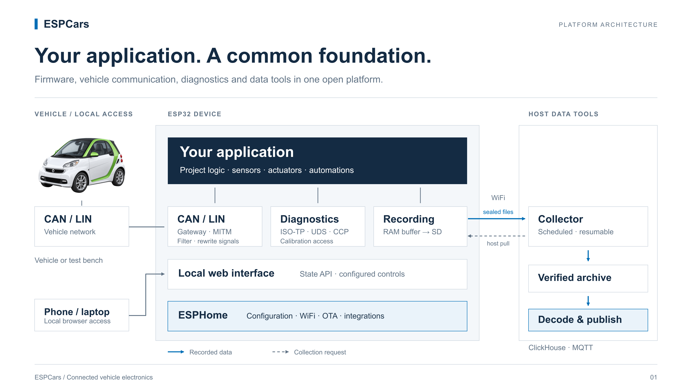
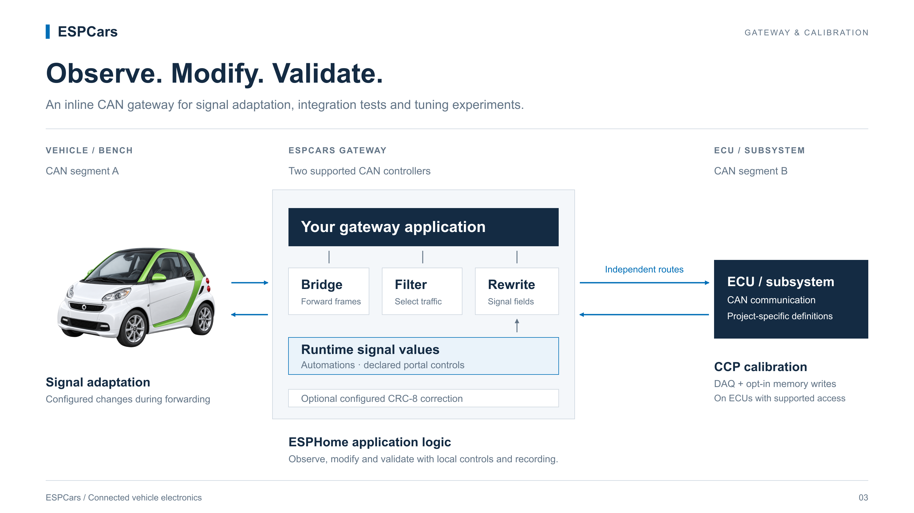
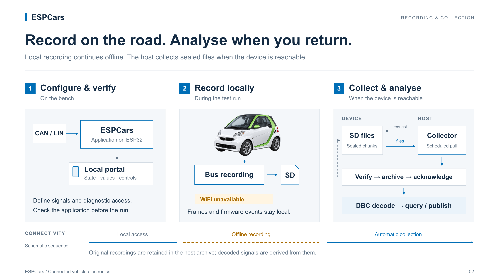

# ESPCars

**The open platform for connected vehicle electronics.**

Build your application. Connect it to the vehicle. Observe, modify and validate.

Developing vehicle electronics means bringing together firmware, bus communication,
diagnostics, configuration, updates, logging and tools for checking the system in
operation. Each project needs these capabilities to work together.

ESPCars provides a common foundation for that work.

Built on ESPHome and ESP32, it combines application logic and connectivity with
CAN, LIN, diagnostic and calibration access, local recording, a browser interface
and automatic data collection. The environment supports development on the bench,
active vehicle integration, tuning experiments and analysis after a test run.
Choose the components your application needs; target support is listed below.



## From application logic to vehicle communication

Use ESPHome's configuration, components and automations to define your application.
Connect sensors and actuators, process signals and expose operating state. ESPHome
also supplies WiFi connectivity, OTA updates and integrations, configured for your
project. ESPCars works as external components against stock ESPHome.

CAN and LIN components connect that application to the vehicle: observe and decode
traffic, schedule communication, implement LIN master or slave behaviour, and
build CAN gateways with filtering and signal modification.

## CAN gateway and man-in-the-middle signal manipulation

Place ESPCars between two CAN segments as an inline, man-in-the-middle gateway.
Define each forwarding direction independently: bridge traffic, filter selected
frames, translate identifiers and rewrite signal fields as frames pass through.
Signal values can change at runtime through ESPHome automations or explicitly
configured portal controls. Supported CRC-8 correction can be applied to modified
frames when configured.



Use this for signal adaptation, controlled fault injection, ECU integration tests
and tuning experiments. Two supported CAN controllers provide the two sides of
the gateway; the application supplies the signal definitions and forwarding rules.
See the [gateway and signal-rewrite guide](docs/can_gateway-user-guide.md).

## Diagnostics, measurement and calibration

Diagnostic communication runs on the device. ISO-TP and catalog-driven UDS provide
access to ECU data alongside normal bus traffic. CCP 2.1 adds memory access,
DAQ measurement and calibration-page selection. Opt-in memory writes support
calibration and tuning workflows on ECUs exposing the supported CCP access;
writes are disabled by default. Signal rewriting and ECU calibration are distinct
tools that can be combined with recording and local controls in one application.

Diagnostic definitions and signal descriptions belong to the project. Reusable
transport, scheduling and decoding infrastructure belongs to the platform. DBC
tooling generates CAN signal configurations; UDS decoding uses a separately
flashed diagnostic catalog.

## A local interface where the work happens

Open the device's web interface from a phone or laptop to inspect configured
values and application state. Declare the nodes and controls needed for
commissioning and testing. The portal page is embedded in the firmware and loads
without external web assets.

The interface travels with the device, giving engineers a direct view of the
system at the bench and inside the vehicle.

## From firmware to field data

Record CAN and LIN frames and firmware events locally while the vehicle is in
use. Recordings carry device and firmware identity, their time basis and explicit
markers when retention discards uncollected chunks.



When the device is reachable over WiFi, a scheduled host collector retrieves the
recordings automatically. It resumes interrupted downloads, verifies the files
and acknowledges collection after archiving them. Host tools decode CAN signals
using DBC definitions into ClickHouse and publish selected results and pipeline
health through MQTT to Home Assistant.

The archive preserves the original recordings; decoded data can be rebuilt when
signal definitions change. See the [recording and collection guide](docs/sd_logger-user-guide.md),
[fleet collector](docs/sdlog-fleet-spec.md), [decoder](docs/sdlog-decode-spec.md)
and [publisher](docs/sdlog-publish-spec.md).

## One foundation, many applications

ECU prototypes. Auxiliary controllers. Inline CAN gateways. Signal adaptation and
tuning rigs. LIN test devices. Diagnostic and calibration nodes. Embedded
recorders. Vehicle integration rigs.

Choose the capabilities your application needs and extend the platform where the
project demands it. Firmware, configuration, diagnostic definitions and data tools
remain inspectable and adaptable. Vehicle-specific definitions stay with the
project that uses them.

## Components

| Component | What it does | Targets |
|---|---|---|
| `can_gateway` | ISR-level CAN⇄CAN gateway: bridge, filter, ID-translate and patch frames between two buses; single-bus observe mode with signal decode into sensors; `can_gateway.send`, cyclic sends, per-ID statistics, bus-off recovery automations. See [`docs/can_gateway-user-guide.md`](docs/can_gateway-user-guide.md) | Any TWAI-capable ESP32 — observe/decode on one bus needs one controller (ESP32, S2, S3, C3, H2), forwarding needs two (C6, P4). Not the C5, see below |
| `linbus` | LIN bus master/slave: frame schedule, slave responses, sniffing (`rx_ids` / `on_frame`), checksum handling (classic/enhanced), self-test, detailed bus statistics. See [`docs/linbus-user-guide.md`](docs/linbus-user-guide.md) | ESP32, ESP32-C3, ESP32-C6 |
| `isotp` | ISO-TP (ISO 15765-2) transport for diagnostics: segments requests and reassembles responses on top of a `can_gateway` port; normal / normal-fixed / extended addressing, flow control, `isotp.send`, `on_message` / `on_error`, per-instance diagnostic counters | ESP32-C6 (on `can_gateway`) |
| `uds` | UDS (ISO 14229) diagnostic client on top of `isotp`: requests, decodes and schedules polling for fields defined in a flashed `.dcat` catalog — no decode rules in firmware or YAML — and publishes them as sensors/text sensors; `uds.read` / `uds.execute` / `uds.raw` / `uds.set_enabled`. See [`docs/uds-user-guide.md`](docs/uds-user-guide.md) | ESP32-C6 (on `isotp`) |
| `ccp` | CCP 2.1 master over a `can_gateway` port: memory access, DAQ, protocol actions and optional writes (`allow_write: false` by default). See the [read/DAQ example](tests/build/ccp/common.yaml) and [write example](tests/build/ccp/common_write.yaml) | Tested build target: ESP32-C6; uses a `can_gateway` observation port |
| `sd_logger` | SD-card bus datalogger: buffers CAN/LIN frames (LIN via the generic `sd_logger.log` action, CAN also via a native `can_gateway` tap) and ESPHome's own log into a RAM ring, drained by a dedicated writer task; rotation, card-failure recovery and optional chunk collection over WiFi. Pure sink — never transmits. See [`docs/sd_logger-user-guide.md`](docs/sd_logger-user-guide.md) | ESP32-C6 |
| `portal` | Local web page and JSON state API: a YAML-declared tree of values, series and optional controls bound to ESPHome entities; embedded assets, optional action authentication and integration with the fallback AP/captive portal. See the [specification](docs/portal-spec.md) and [example](tests/build/portal/common.yaml) | ESP32 with ESP-IDF; tested build/bench target: ESP32-C6 |

## Quick start

```yaml
external_components:
  - source: github://kipp-ing/ESPCars
    components: [can_gateway, linbus]

can_gateway:
  ports:
    - id: car
      rx_pin: GPIO3
      tx_pin: GPIO2
      bit_rate: 500kbps

sensor:
  - platform: can_gateway
    port_id: car
    can_id: 0x2A0
    offset: 2
    length: 2
    name: "Battery Voltage"
    filters:
      - multiply: 0.01
```

See `tests/build/` for complete, compiling example configurations of every feature.

## Hardware

Developed against the ESP32-C6 reference adapter board (CAN + Modbus + LIN
transceivers). Choose an ESP32 target supported by the components you need, plus
the appropriate physical interfaces: a CAN transceiver (e.g. TJA1051, SN65HVD230)
for `can_gateway`, a LIN transceiver (e.g. TJA1021) for `linbus`, and an SPI SD card
for `sd_logger`. CAN bridging needs two supported on-chip CAN controllers; a
single-bus observer needs one.

> **Warning**: These components can *transmit* on vehicle buses. Writing to a
> car's CAN or LIN bus can trigger real actuators. Start in observe/listen-only
> configurations and only send frames you understand, on buses you own.

## Development & testing

```bash
python3 -m venv .venv && .venv/bin/pip install -r requirements_test.txt
script/check.sh                              # pytest + clang-format + every config
.venv/bin/python -m pytest tests/ -q         # component schema/codegen tests
make -C tests/host                           # C++ unit tests for the ISR-side core
.venv/bin/esphome config tests/build/can_gateway/test.esp32-c6-idf.yaml   # validate
.venv/bin/esphome compile tests/build/can_gateway/test.esp32-c6-idf.yaml  # full build
```

`tests/host/` compiles `can_gateway/gateway_core.h` — the rule engine, slot
pool, frame rings and recovery backoff that run inside the RX interrupt — with a
plain host compiler under ASan/UBSan, because that header is deliberately free
of ESPHome and ESP-IDF dependencies.

CI runs the schema tests and the host tests, validates every build config, and
compiles the full target matrix on every PR.

Beyond CI there is a permanent hardware-in-the-loop bench — three reference
boards (Mr. Green, Mr. Blue, Mr. Orange) running a token ring across LIN and
two gateway-bridged CAN segments under load. See `tests/hil/HIL.md`;
`script/hil/verify.py` must exit green before a release.

## License

Same dual-license scheme as ESPHome: C++ under GPLv3, Python and everything else
under MIT. See [LICENSE](LICENSE).
