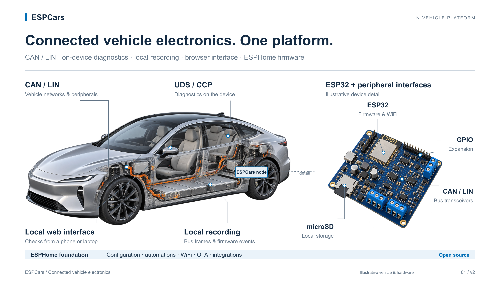
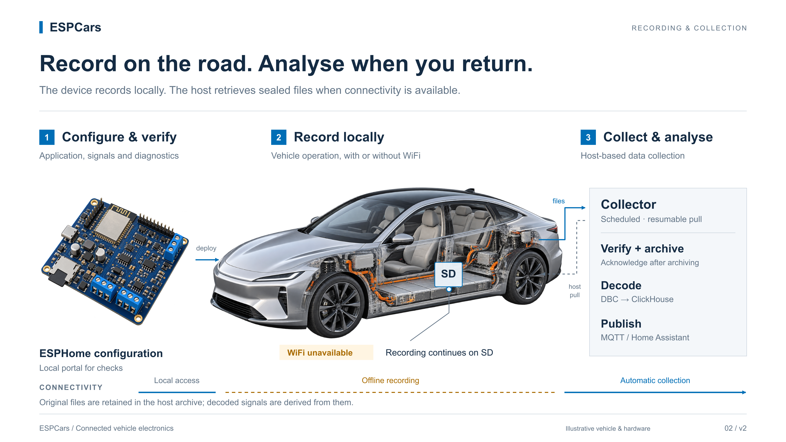

# ESPCars infographic layout drafts

Layout iteration v2, 2026-10-13. Visual direction: technical OEM presentations,
white background, navy typography and blue data paths. High-quality vehicle and
board renders provide the visual base; SVG labels, leaders and data paths explain
the system. These are editable review drafts, not yet embedded in the main README.

## Render-based drafts (v2)

| Draft | Preview | Editable SVG composition |
|---|---|---|
| In-vehicle platform and hardware detail | [PNG](01-platform-render-v2.png) | [SVG](01-platform-render-v2.svg) |
| Recording and collection workflow | [PNG](02-field-data-render-v2.png) | [SVG](02-field-data-render-v2.svg) |

The SVGs embed their raster assets, so they remain portable without separate image
files. All text, labels, leaders, arrows and timeline elements are editable vector
elements. The original transparent assets remain available separately:
[vehicle](assets/vehicle-render-v2.png), [board](assets/board-render-v2.png).
The [generation prompts](render-prompts.md) document the art direction.

Vehicle and board are illustrative concepts, not a specific OEM vehicle or an
exact depiction of the manufactured reference PCB. Function locations and data
paths are schematic. The hardware illustration is not a pinout or wiring guide.

## Original vector drafts (v1)

| Draft | Preview | Editable source |
|---|---|---|
| Platform architecture | [PNG](01-platform.png) | [SVG](01-platform.svg) |
| Recording and collection workflow | [PNG](02-field-data.png) | [SVG](02-field-data.svg) |

Both versions use a 1600 × 900 SVG viewBox and 3200 × 1800 PNG previews.
Text uses Arial with Helvetica/sans-serif fallbacks. V1 contains only vector
geometry; v2 combines embedded raster illustrations and vector annotations.
Neither version requests remote assets or fonts.

The platform diagram distinguishes the on-device firmware components from the
host-side collector, archive, decoder and publisher. Data flows towards the host;
the collection request originates at the host. The workflow illustrates local
recording without WiFi and subsequent collection when the host can reach the
device. The timing and signal sketches are schematic and contain no measurements.

